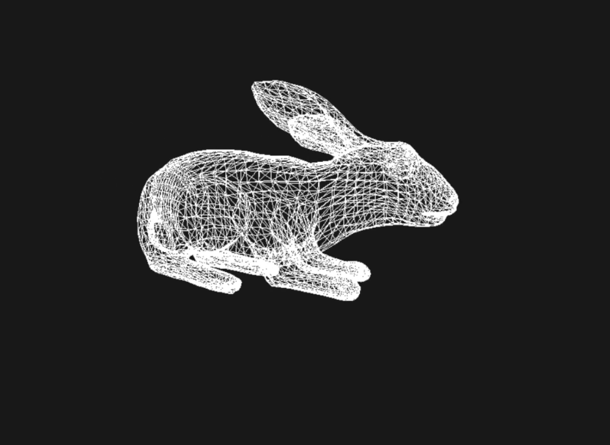

# ❄️ BorealEngine

**BorealEngine** is a game engine built from scratch. It is currently at an early stage of development: the core libraries, a DirectX 12 renderer, and glTF model loading are in place.

> ⚠️ \*\*Status: under active development.\*\* The API is unstable and may change without notice.
<p align="center"></p>

## Features

* Rendering of 3D models in **glTF** format
* Camera controls
* **DirectX 12** renderer
* Platform: **Windows**

## Roadmap

* \[ ] **Vulkan** support
* \[ ] Support for additional platforms
* \[ ] *Add your near-term goals here: materials, lighting, animation, etc.*

## Architecture

The engine is split into independent libraries (modules):

|Module|Purpose|
|-|-|
|**core**|Fundamental types and utilities used by all other modules|
|**math**|Math library (vectors, matrices, etc.)|
|**geometry**|Geometric primitives and geometry handling|
|**platform**|Platform abstraction: windowing, input, system calls|
|**render**|Rendering subsystem (currently DirectX 12)|
|**scene**|Scene, objects, and camera|

## Supported Platforms and Graphics APIs

|Platform|Graphics API|Status|
|-|-|-|
|Windows|DirectX 12|✅ Supported|
|Windows|Vulkan|🕓 Planned|
|Linux|Vulkan|🕓 Planned|

## Building

### Requirements

* Windows 10/11
* Visual Studio 2022 or later
* Windows SDK with DirectX 12 support

### Steps

```bash
git clone https://github.com/<your-username>/BorealEngine.git
cd BorealEngine
```

And open BorealEngine\\engine\\BorealEngine.slnx using Visual Studio 2022 or later

## Camera Controls

|Action|Keys / Mouse|
|-|-|
|*Move*|*e.g., W A S D*|
|*Rotate*|*e.g., right mouse button + drag*|


## Repository Structure

```
BorealEngine/
├── core/
├── math/
├── geometry/
├── platform/
├── render/
├── scene/

```

## License

*Specify a license (e.g., MIT) and add a `LICENSE` file.*

## Contact

Author: [@AlexGalkin8](https://github.com/AlexGalkin8)

