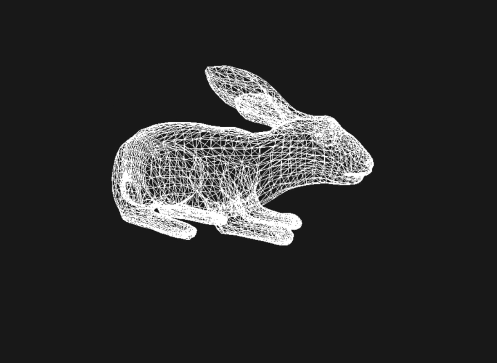

# ❄️ BorealEngine

**BorealEngine** is a personal game engine project focused on real-time rendering. It is at an early stage of development, with a Windows/DirectX 12 backend, glTF model loading, JSON scene descriptions, and an FPS camera.

<p align="center">
  
</p>
<p align="center"><em>A saved BorealEngine screenshot showing a rabbit model in wireframe. The default sample scene may differ.</em></p>

> **Status: under active development.** APIs and asset formats may change. The screenshot records an earlier result; it does not establish the runtime state of the current revision.

## Current scope

- Windows and DirectX 12.
- Static model import through tinygltf.
- JSON scene descriptions with model placement and camera settings.
- FPS camera movement and mouse look.

These describe the current source structure, not a claim that all glTF features or rendering scenarios are supported. Current baseline verification is tracked in [the rendering baseline task](agent/tasks/001-render-baseline.md).

## Direction

The selected baseline is:

**Depth prepass → G-buffer → deferred lighting → postprocessing**

A minimal Dear ImGui editor is also planned for level creation and object placement. These are development goals, not completed features. The proposed stages and acceptance criteria are in [the roadmap](agent/Roadmap.md).

Vulkan and additional platforms remain open directions; they are not committed milestones. See [the project brief](agent/ProjectBrief.md) for goals and open questions.

## Build

### Requirements

- Windows 10/11, x64, with a DirectX 12-capable GPU and driver.
- Visual Studio 2026 with **Desktop development with C++** and the **MSVC v145** toolset.
- Windows SDK with DirectX 12 headers and libraries, including `dxcapi.h`.
- Git with submodule support.

The current Visual Studio projects specify C++20 and provide Debug and Release configurations for x64.

### Get the sources

```powershell
git clone --recurse-submodules https://github.com/AlexGalkin8/BorealEngine.git
cd BorealEngine
```

For an existing checkout, initialize the tinygltf submodule:

```powershell
git submodule update --init --recursive
```

### Build the solution

Open `engine/BorealEngine.slnx` in Visual Studio and select **Debug | x64** or **Release | x64**.

Alternatively, run these commands from **Developer PowerShell for Visual Studio 2026** at the repository root:

```powershell
msbuild engine/BorealEngine.slnx /m /p:Configuration=Debug /p:Platform=x64
msbuild engine/BorealEngine.slnx /m /p:Configuration=Release /p:Platform=x64
```

Use the checked-in solution. `scripts/generate_sln.bat` invokes CMake, but the repository currently has no CMake configuration.

## Run the sample

1. Set **BorealSample1** as the startup project.
2. Set its debugger **Working Directory** to `$(ProjectDir)` (the `samples/BorealSample1` directory).
3. Make the x64 DXC runtime available to the executable: `dxcompiler.dll` and its matching `dxil.dll`, for example beside the executable. Shader compilation happens at runtime.
4. Check the shader source path before launching. It is currently hardcoded to `C:/Projects/BorealEngine/engine/shaders` in [d3d12shadercompiler.cpp](engine/source/render/source/interface/d3d12/d3d12shadercompiler.cpp). A checkout elsewhere requires adjusting that constant and rebuilding.
5. Launch the sample with the selected configuration.

The executable is built under `samples/BorealSample1/build/bin/x64/<Configuration>/`. Launching it directly still requires `samples/BorealSample1` as the working directory.

The sample reads `data/settings.json`, which selects the scene and input configuration. The default scene is `data/scenes/default_scene/default_scene.json`; its model names resolve under `data/scenes/default_scene/models/`. Keep referenced model files and their external resources available.

### Tools

See the [tools guide](docs/tools.md) for command-line commands and GPU capture.

### Controls

| Action | Default input |
|---|---|
| Move forward / backward | W / S |
| Move left / right | A / D |
| Move up / down | E / Q |
| Move faster | Hold Left Shift |
| Look around | Hold right mouse button and move the mouse |
| Toggle the debug menu and panels | F1 |
| Toggle borderless fullscreen | F11 |

Movement bindings, speed, sprint multiplier, and mouse sensitivity are configured in `samples/BorealSample1/data/input.json`. Mouse look is currently gated directly by the right mouse button in the Windows input implementation.

## Architecture

| Module | Purpose |
|---|---|
| core | Fundamental types, utilities, and CPU asset import |
| math | Vectors, matrices, and transforms |
| geometry | Geometry code |
| platform | Windows windowing and input |
| render | Rendering interfaces and DirectX 12 backend |
| scene | Scene objects, model resources, and cameras |
| engine | Engine setup and main loop |

## Repository structure

```text
BorealEngine/
├── agent/                      Project goals, decisions, tasks, and devlog
├── docs/                       Usage guides and saved screenshots
├── engine/
│   ├── BorealEngine.slnx       Main Visual Studio solution
│   ├── include/engine/         Public headers
│   ├── source/                 Engine modules
│   ├── shaders/                HLSL sources
│   └── third_party/            Dependencies, including the tinygltf submodule
├── samples/BorealSample1/
│   ├── BorealSample1.vcxproj   Sample application project
│   ├── source/                 Sample entry point
│   └── data/                   Settings, input bindings, scenes, and models
└── scripts/                    Helper scripts
```

## Contact

Author: [Aleksandr Galkin](https://github.com/AlexGalkin8) · [X](https://x.com/alexandgalkin)
